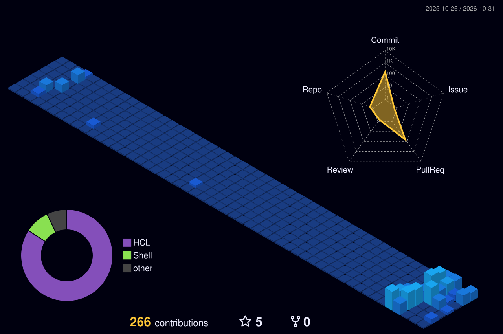

# Ignacio Gaitán · Infrastructure & Automation

I build and automate infrastructure, from Linux servers and networks to Kubernetes and GitOps pipelines. My focus is on making systems reliable, secure, and increasingly autonomous, with a growing interest in how AI can help operate them.

**Open to:** Junior SysAdmin · DevOps · Cloud / Infrastructure roles

---

### Tech Stack

  &nbsp;&nbsp;
  &nbsp;&nbsp;
  &nbsp;&nbsp;
  &nbsp;&nbsp;
  &nbsp;&nbsp;
  &nbsp;&nbsp;
  &nbsp;&nbsp;
  
    
  &nbsp;&nbsp;
  &nbsp;&nbsp;
  &nbsp;&nbsp;
  &nbsp;&nbsp;
  &nbsp;&nbsp;
  &nbsp;&nbsp;
  &nbsp;&nbsp;
  

---

### Current Focus

* **Infrastructure as Code & GitOps** — Hybrid platform on Proxmox VE + AWS with Terraform, Ansible, k3s and Argo CD.
* **Cloud** — Extending on-prem workloads to public cloud and learning cloud-native architecture.
* **Automation & CI/CD** — Pipelines and workflows that build, test, and deploy without manual steps.
* **AIOps** — Observability as a foundation: metrics, logs, and AI-assisted operations.
* **AI agents for infrastructure** — Experimenting with LLM-driven agents that help operate and troubleshoot systems.

---

### Featured Projects

<b>Infrastructure & DevOps</b>

 

* **[tfg-plataforma-hibrida](https://github.com/nachogtan/tfg-plataforma-hibrida)** — Hybrid Infrastructure-as-Code platform spanning Proxmox VE and AWS, connected through a NetBird (WireGuard) mesh network. Final project for my ASIR degree.
* **[Docker-iac-network-deployment](https://github.com/nachogtan/Docker-iac-network-deployment)** — Containerized network deployment defined as code: segmented topology with NGINX as web server, Pi-hole as DNS resolver, and multiple Ubuntu clients.
* **[Multi-Homed Router & Firewall with Debian](https://github.com/nachogtan/Home-Lab-Project-Building-a-Multi-Hommed-Router-and-Firewall-with-Debian)** — Lab simulating a real-world network, with a Debian server acting as router and firewall between Windows Server and Linux hosts across multiple segments.

<b>Scripting & Tools</b>

 

* **[script_task_helper](https://github.com/nachogtan/script_task_helper)** — Interactive Bash tool that guides new Linux users through common system tasks.

---

### GitHub Activity

  

---

### Let's Connect

  &nbsp;
  

